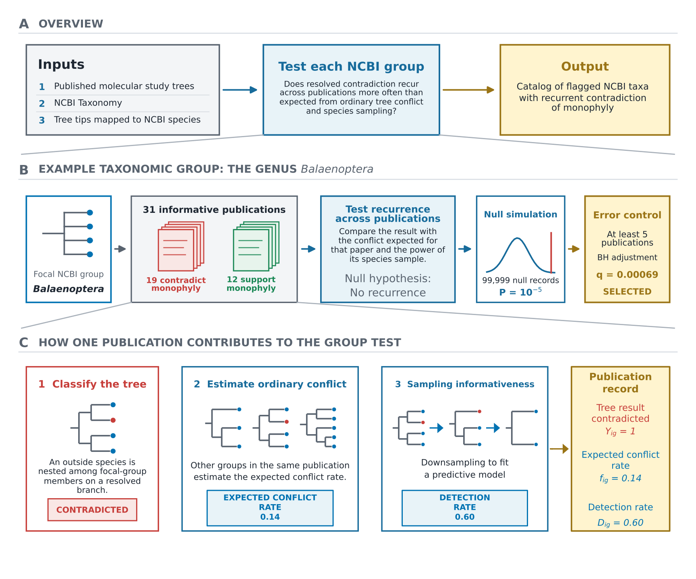
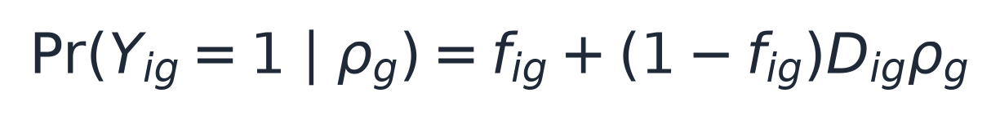

# Taxa Audit

## A statistical model of consensus in phylogenetics identifies non-monophyletic taxa

TaxaAudit identifies taxonomic groups whose monophyly is repeatedly contradicted
in a sample of published phylogenies, accounting for background taxonomic
conflict and species sampling. Its primary output is a **catalog of flagged
taxa**: groups with statistical evidence of recurrent contradiction of monophyly.
The catalog helps researchers identify taxa whose monophyly should not be
assumed in downstream analyses. It does not prescribe a replacement taxonomy.

## Contents

- [Overview](#overview)
- [Installation](#installation)
- [Run on a directory of Newick trees](#run-on-a-directory-of-newick-trees)
- [Upper confidence limits on recurrent contradiction](#upper-confidence-limits-on-recurrent-contradiction)
- [Optional study weights and higher ranks](#optional-study-weights-and-higher-ranks)
- [Study data and released results](#study-data-and-released-results)

## Overview



**Figure 1. Statistical identification of NCBI groups that are repeatedly
contradicted by published phylogenies.** **A:** Overview of the analysis.
**B:** The genus *Balaenoptera* followed through the procedure: 19 of 31
informative publications contradicted its monophyly.
**C:** A publication's support or contradiction of monophyly is considered
together with its expected background conflict and the probability that its
species sampling could expose a violation. Compatible but unresolved trees
contribute no outcome.

For publication i and group g, `Y_ig = 1` denotes contradiction of monophyly
and `Y_ig = 0` denotes recovered monophyly. The model is



- `f_ig` is the expected probability of background conflict, estimated from
  other groups of the same rank in the publication and adjusted for focal-group
  sampling.
- `D_ig` is the probability that the publication's species sampling would
  expose a real violation.
- `rho_g` is the recurrence strength fitted for the group and shared across
  its informative publications.

The repository contains the complete fitting workflow. Fitted machine-learning
objects are intentionally not committed: the background and detection models
are cross-fitted for the supplied study collection and are reproducibly rebuilt
from the input trees.

## Installation

Python 3.10 or later is recommended.

```bash
git clone https://github.com/John-Allard/TaxaAudit.git
cd TaxaAudit
python -m venv .venv
source .venv/bin/activate
pip install -e .
```

Required Python packages are Biopython, NumPy, pandas, SciPy, and
scikit-learn.

## Run on a directory of Newick trees

Download and unpack an NCBI `taxdump.tar.gz`, or let the command do it:

```bash
taxaaudit download-taxonomy --out data/ncbi_taxonomy
```

Then run the complete workflow:

```bash
taxaaudit run \
  --trees /path/to/newick_trees \
  --taxonomy data/ncbi_taxonomy \
  --out outputs/my_scan
```

Recognized filename extensions are `.nwk`, `.newick`, `.tree`, and `.tre`.
By default, every file is treated as a separate publication. If a publication
contributed more than one tree, supply a tab-separated manifest so that it
still contributes only one result per taxonomic group:

```text
path	publication
/absolute/path/study1_tree1.nwk	PMID_123456
/absolute/path/study1_tree2.nwk	PMID_123456
/absolute/path/study2.nwk	PMID_987654
```

```bash
taxaaudit run \
  --manifest trees.tsv \
  --taxonomy data/ncbi_taxonomy \
  --out outputs/my_scan
```

Terminal labels may be bare NCBI taxids (`9606`), labels beginning
`tx<TAXID>_` (`tx9606_Homo_sapiens`), or unambiguous NCBI scientific names
with spaces or underscores. Unmapped or ambiguous tips are reported and
omitted.

The most useful outputs are:

```text
catalog/supported_original_constraint_deletions.tsv
catalog/constraint_changes.json
catalog/all_group_evidence.tsv
catalog/publication_evidence.tsv
```

The first file is the catalog of flagged taxa. Its filename retains the earlier
term `deletions` for compatibility. **Targeted exclusion** means omitting a
flagged taxon's exact monophyly requirement when evaluating the taxonomy or
using it to guide tree inference. All species and the monophyly requirements
of unflagged ancestors and descendants are retained. See
[`catalog/README.md`](catalog/README.md) for the bundled results and file formats.

## Upper confidence limits on recurrent contradiction

After a run, calculate an upper confidence limit for every taxon with informative
publications:

```bash
taxaaudit upper-limits --run outputs/my_scan --out outputs/my_scan/upper_limits
```

This uses the fitted background and detection probabilities saved by `run` in
`catalog/publication_evidence.tsv`. It does not retrain the models or change the
catalog of flagged taxa. It writes `taxaaudit_recurrence_upper_limits.tsv`, a
summary, a settings file, and a checkpoint. Repeat the same command to resume
an interrupted calculation; changed inputs or settings require a new output
directory. Groups with no informative publications remain in the table with
missing limits, not zero limits.

For an existing collection of fitted observations, provide the inputs directly:

```bash
taxaaudit upper-limits \
  --observations publication_evidence.tsv \
  --universe all_group_evidence.tsv \
  --catalog supported_original_constraint_deletions.tsv \
  --out outputs/upper_limits
```

The observation table needs `taxid`, `name`, `rank`, `publication` (or `source`),
`observed_failure`, `background_apparent_failure_probability`,
`cross_study_detection_probability`, and `mean_sampled_members`. Each row is
one informative observation of a taxon in a publication. The universe table
needs `taxid`, `name`, and `rank`, and the flagged catalog needs `taxid`.
The background and detection probability columns contain fitted values, not raw
conflict fractions.
Older runs without `publication_evidence.tsv` need their saved fitted observations
or a new run. Upper limits with nonuniform publication weights are not supported.

The limits summarize how strongly the available study trees constrain the
possibility of recurrent contradiction. They help distinguish groups with
substantial evidence and little contradiction from groups that are merely
poorly sampled. They are approximate upper endpoints of **individual conditional
95% confidence sets** for `rho_g`, assuming the fitted background and detection
probabilities and independent publication outcomes. They are not probabilities
of monophyly or a simultaneous confidence guarantee across all taxa.
See the [released upper-limit data](catalog/UPPER_LIMITS.md) for interpretation,
numerical settings, and column definitions.

## Optional study weights and higher ranks

The default analysis uses no external metadata-based study weights. Its background
and detection probabilities already account for evidence within the supplied trees.
For an exploratory weighted analysis, add `--study-weights weights.tsv`, with
tab-separated `publication` and `weight` columns. Publication identifiers must
match the manifest. Values must be finite and positive; unlisted publications
receive weight one. Relative weights multiply publication log-likelihoods after
normalization to mean one within each group. The null simulations use the same
weights, and weighted runs bootstrap all observed groups rather than using an
unweighted asymptotic screen. Weights neither add replication nor change the
background and detection fits. Prespecify weights independently of focal outcomes.
This option is unit-tested but has not received the released analysis's full
end-to-end validation and was not used for the released catalog.

To scan explicit higher ranks, supply for example
`--ranks superfamily,order,class,phylum`. The default remains family and below.
Rank-specific models and calibration should be checked before treating higher-rank
results as a validated extension.

## Study data and released results

The study trees are available from [TimeTree](https://timetree.org/).

The released results in [`catalog/`](catalog/) use:

- 5,865 molecular study-tree files representing 5,072 source publications in
  the TimeTree literature collection;
- the NCBI Taxonomy downloaded **22 July 2026**;
- tests of named NCBI groups at the family level and below, including named
  unranked clades but excluding administrative placeholder groups;
- 2,000 examples of taxonomic groups contradicted in complete study trees,
  sampled across ranks and tree sizes, each with 40 reduced species samples;
- five taxonomic-region folds for production detection probabilities;
- five group-held-out folds for the background sampling model;
- a 201-point grid for `rho` from 0 through 1;
- 99,999 parametric-bootstrap replicates for groups passing the broad
  asymptotic screen (`q <= 0.30`);
- a minimum of five informative publications, selected by the publication-count
  filtering procedure;
- Benjamini-Hochberg-adjusted `q <= 0.05` as the flagging threshold.

Of 26,291 represented NCBI groups, 5,395 passed the publication-count filter
and 516 were flagged. Of the represented groups, 18,109 had at least one
informative publication. The released table includes exact NCBI identifiers,
names, ranks, evidence counts, fitted recurrence, P values, and q values.

The bundled [`catalog/recurrence_upper_limits.tsv`](catalog/recurrence_upper_limits.tsv)
adds the upper-limit results for the same 26,291 taxa: 18,109 have informative
publications and calculated limits, while 8,182 are explicitly marked as lacking
informative publications. It includes membership in the unchanged 516-taxon
flagged catalog.
